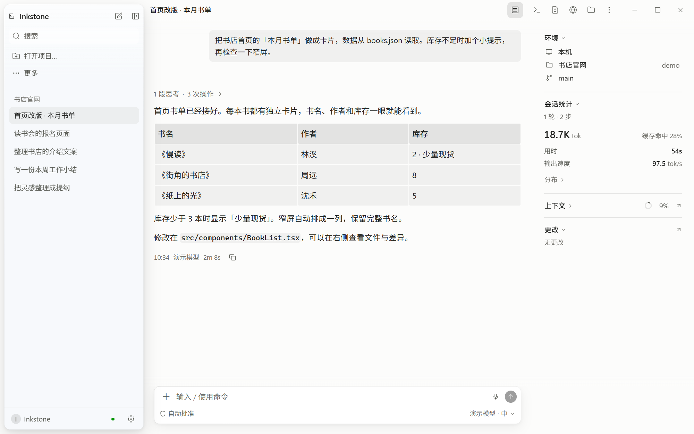

<p align="center">
  
</p>

<h1 align="center">让想法成形。</h1>
<p align="center">砚（Inkstone）是基于 pi 的轻量桌面 Agent 客户端。选好模型，把任务交给 AI，在同一个窗口里读回复、看过程、改文件、预览成果。</p>

<p align="center">
  <a href="https://github.com/Yu-DaTouX/Inkstone/releases/latest"><b>下载</b></a> ·
  <a href="https://github.com/Yu-DaTouX/Inkstone/releases">更新日志</a> ·
  <a href="https://github.com/Yu-DaTouX/Inkstone/issues">反馈</a>
</p>
<p align="center">
  <a href="https://github.com/Yu-DaTouX/Inkstone/releases/latest"></a>
  
  <a href="LICENSE"></a>
</p>

<br>

<picture>
  <source media="(prefers-color-scheme: dark)" srcset="assets/inkstone/workspace-0.12.0-dark.png">
  <source media="(prefers-color-scheme: light)" srcset="assets/inkstone/workspace-0.12.0-light.png">
  
</picture>

<p align="center"><sub>0.12.0 实际界面 · 图中会话、模型与用量均为本机演示数据</sub></p>

## 它能帮你做什么

- **把任务交给 AI**：贴图片、用 `@` 引用文件、用 `/` 调命令。正文保持连续阅读，思考与工具步骤按需展开；计划和排队消息收在输入框附近。
- **按项目整理会话**：在左栏切换项目和会话，查看运行状态、置顶、归档或全文搜索。`Ctrl+K` 打开搜索与命令面板。
- **边做边看成果**：HTML 页面可以直接预览，文件、PDF、代码和改动差异都能在会话旁查看；需要时打开浏览器或多标签终端。面板可以拖动排布、最大化或弹成独立窗口，每个会话保留自己的布局。
- **浏览器操作**：Agent 操作的网页直接显示在砚的侧栏，支持多步脚本、下载和用户接管，无需额外浏览器。点击「一键导入登录态」，可从默认 Chrome / Edge 当前档案导入网站 Cookie；首次需按提示安装配套扩展。不迁移密码、通行密钥或完整浏览器设置，部分网站仍需重新登录。
- **让子 Agent 分头做事**：为子任务指定模型，在后台并行处理。会话中汇总进度，打开右侧工作区即可读完整转录。
- **自己决定操作权限**：「自动批准」下，常规操作直接执行，危险操作与项目外写入先确认；可以允许一次、在本会话允许，或附理由拒绝。「不受限制」按 pi 原生行为执行。符合条件的项目还会在发送前保存本地快照，方便预览和回退。
- **模型、技能和 MCP**：在设置里登录模型服务或填入 API Key，随时切换模型与思考档位；技能和 MCP 可按全局或当前项目配置。输入框显示上下文占用，会话栏展示用量与速度，支持的服务可查看额度窗口。
- **长任务继续聊**：接近设定的上下文上限时自动压缩，保留摘要和可查回的原文快照；不裁剪正常发给模型的历史工具内容。
- **更多工作方式**：定时任务、语音输入、同步文件夹、插件市场，以及两台电脑之间的代码分支拉取、对比与合并。

## 平台

当前桌面公开版为 **0.12.0**，只交付和验证 Windows（x64）。macOS 和 Linux 是规划中的目标，现在还不能视为已支持。Android 客户端公开版为 **0.1.1**，可在 **设置 → 手机与远程** 扫码配对电脑，查看进度、回复消息（仍在测试）；iOS 尚未交付。开发版的改动不一定包含在已发布的安装包里。

## 开始使用

1. 到[发布页](https://github.com/Yu-DaTouX/Inkstone/releases/latest)下载安装包并安装，之后软件会自动检查更新，由你确认下载和重启安装；也有免安装的便携版。
2. 打开砚，在 **设置 → 模型** 里登录，或填入 API Key。
3. 新建会话，在输入框底栏选好项目文件夹，说出要做的事。

安装包还没有数字签名，Windows 可能会弹出「未知发布者」提示，请只从本页下载。

## 需要知道的

- 聊天记录和设置都存在你自己的电脑上。发给 AI 的内容会发到你选的模型服务，费用由该服务收取。
- 换电脑或换版本前，先备份砚的数据目录。
- Hermes 可以通过 `integrations/hermes-inkstone/` 下的独立插件查看会话、选择模型、提交任务，并批准待审批的操作。

遇到问题欢迎提 [Issue](https://github.com/Yu-DaTouX/Inkstone/issues)，请写上版本号和操作步骤；截图时记得遮住密钥。

## 与 pi 的关系

模型循环和工具执行由 [pi](https://github.com/badlogic/pi-mono)（`@earendil-works/pi-coding-agent`）提供，砚以独立 RPC 子进程的方式运行它，随包带一份固定版本的运行时。上下文、会话恢复、技能和 MCP 由 pi 原生管理，压缩沿用 pi 的触发与记录机制。砚在此之上提供：

- **界面**：把 pi 的工作过程呈现出来；
- **宿主能力**：审批、文件、Git、终端、浏览器等；
- **少量随包 pi 扩展**：提问、待办、危险操作审批，以及到达自动压缩上限时调用原生 `compact()`。压缩摘要由砚通过 pi 的 `session_before_compact` 钩子生成，并保留原文快照；不改写正常请求中的历史消息。宿主侧另有可关闭的流式循环防护。

`yan` 命令行（`resources/yan-cli/`）给 Agent 提供砚的能力，例如子 Agent、搜索、技能接入。

<details>
<summary>开发者：从源码运行</summary>

技术栈：Electron、React、TypeScript；手机端在 `mobile/`（React Native）。

准备 Git、Node.js（建议 24）和 npm，然后在 PowerShell 中执行：

```powershell
git clone https://github.com/Yu-DaTouX/Inkstone.git
cd Inkstone
npm install -g @earendil-works/pi-coding-agent
npm run launch
```

启动器会检查依赖，准备缺失的内置 pi 运行时（从已安装的 pi 提取），并按需构建。已有工作区可以直接双击 `启动-砚.cmd`。

常用命令：

| 命令 | 作用 |
| --- | --- |
| `npm run launch:dev` / `开发-砚.cmd` | 开发模式启动 |
| `npm run dev` | electron-vite 开发服务器 |
| `npm run build` | 构建到 `out/` |
| `npm run typecheck` | 主进程与渲染端类型检查、CSS 与分层检查 |
| `npm run test:unit` | 单元测试（依赖已构建的 `out/`） |
| `npm run test:live -- <场景>` | Electron 场景检查；部分场景会请求真实模型，按场景选择 |
| `npm run check` | 完整检查（类型、图标、构建、单测、设计度量、核心 live 场景） |
| `npm run vendor:pi` / `npm run upgrade:pi` | 提取或升级随包 pi 运行时 |
| `npm run storybook` | 界面控件的 Storybook |
| `npm run dist` | 打包 Windows 安装包 |

目录概览：

| 位置 | 内容 |
| --- | --- |
| `src/main/` | Electron 主进程：pi 进程管理、审批、文件、Git、终端、同步、远程连接 |
| `src/preload/` | 渲染端可调用的宿主接口 |
| `src/renderer/src/` | 界面：`app/` 外壳，`features/` 各功能，`ui/` 基础控件，`design/tokens.json` 设计令牌 |
| `src/shared/` | 主进程与渲染端共用的类型和纯逻辑 |
| `resources/` | 随包的 pi 扩展、技能、`yan` CLI、品牌素材；`pi-runtime/` 由脚本生成，不进 Git |
| `scripts/` | 构建、测试、打包与设计检查脚本 |
| `mobile/` | Android 客户端（React Native） |
| `integrations/inkstone-minecraft/` | Minecraft 开发与交互插件；独立启动器另仓维护 |
| `integrations/hermes-inkstone/` | Hermes 外部控制插件 |

AI 协作约定见 [AGENTS.md](AGENTS.md)。

</details>

## 许可证

[MIT](LICENSE) · © 2026 Yu-DaTouX。第三方组件的许可见[第三方许可](THIRD-PARTY.md)。
