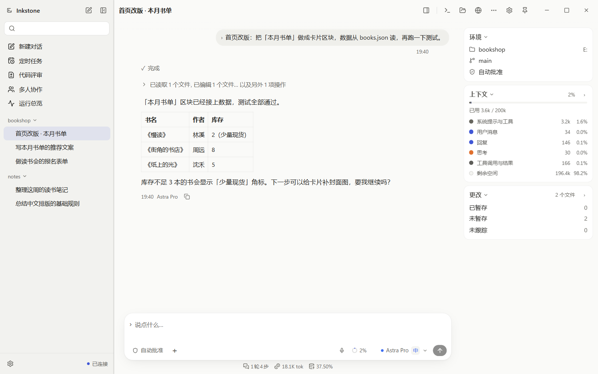

<p align="center">
  
</p>

<h1 align="center">让想法成形。</h1>
<p align="center">砚（Inkstone）是基于 pi 的轻量图形 Agent 客户端：选好模型，交代任务，在同一个窗口里查看工具过程、文件改动和结果。</p>

<p align="center">
  <a href="https://github.com/Yu-DaTouX/Inkstone/releases/latest"><b>下载</b></a> ·
  <a href="https://github.com/Yu-DaTouX/Inkstone/releases">更新日志</a> ·
  <a href="https://github.com/Yu-DaTouX/Inkstone/issues">反馈</a>
</p>
<p align="center">
  <a href="https://github.com/Yu-DaTouX/Inkstone/releases/latest"></a>
  
  <a href="LICENSE"></a>
</p>

<br>

<picture>
  <source media="(prefers-color-scheme: dark)" srcset="assets/inkstone/workspace-v3-dark.png">
  <source media="(prefers-color-scheme: light)" srcset="assets/inkstone/workspace-v3-light.png">
  
</picture>

<p align="center"><sub>界面示意 · 图中内容均为演示数据</sub></p>

## 它能帮你做什么

- **像聊天一样把活交出去**：可以贴图片、用 `@` 引用文件、用 `/` 调命令，输入框里的文件引用、代码块和行内格式按原样发出；空输入框按 `↑` 取回本会话之前发过的话；排队的消息可以编辑、调整顺序或一键清除。AI 读了什么、改了什么、跑了什么，都按工具步骤收起来，点开就能看详情。
- **会话为主**：左栏按项目文件夹列出会话，显示每个会话的运行状态；支持归档、置顶和全文搜索。`Ctrl+K` 打开搜索与命令面板。
- **右侧工作区**：在会话旁打开改动、终端、文件、浏览器、预览与编辑、上下文、分支、日志、额度等面板，可以拖动排布、最大化，也可以弹出成独立窗口；每个会话记住自己的面板布局，窗口变窄时自动让出空间保证对话可读。文件面板会自动刷新，预览支持 PDF 等格式；终端可以开多个标签；改动面板列出改动文件并依次展开各文件的差异，可以按范围查看补丁，也能对比图片。
- **子 Agent**：为子任务指定模型，子 Agent 在后台并行工作；对话里以卡组显示进度，点开后在右侧工作区查看完整转录。
- **两档权限**：「自动批准」下常规操作直接执行，危险操作和写到项目之外的操作会先问你，审批时可以选「允许这一次」「在此会话中允许」或「拒绝」，拒绝时可以附上理由告诉 AI，被拒的步骤在对话里标为「已拒绝」；「不受限制」完全按 pi 原生行为执行。
- **改坏了能退回**：发送前会为符合条件的项目保存本地快照，可以先预览变更，再确认回退。
- **模型随你选**：在设置里登录或填入 API Key 即可使用，随时切换；输入框旁的圆环显示上下文占用，额度在工作区的额度面板里查看。
- **更多**：定时任务；多人协作（两台电脑之间用类似 Git 的方式拉取、对比、合并分支）；同步文件夹；插件市场（砚适配插件与 pi 生态包）；语音输入。

## 平台

当前只交付和验证 Windows（x64）。macOS 和 Linux 是规划中的目标，现在还不能视为已支持。安卓手机可以在 **设置 → 手机与远程** 里扫码配对电脑，查看进度、回复消息（仍在测试）。开发版的改动不一定包含在已发布的安装包里。

## 开始使用

1. 到[发布页](https://github.com/Yu-DaTouX/Inkstone/releases/latest)下载安装包并安装，之后软件会自动检查更新，由你确认下载和重启安装；也有免安装的便携版。
2. 打开砚，在 **设置 → 模型** 里登录，或填入 API Key。
3. 新建会话，在输入框底栏选好项目文件夹，说出要做的事。

安装包还没有数字签名，Windows 可能会弹出「未知发布者」提示，请只从本页下载。

## 需要知道的

- 聊天记录和设置都存在你自己的电脑上。发给 AI 的内容会发到你选的模型服务，费用由该服务收取。
- 换电脑或换版本前，先备份砚的数据目录。
- Hermes 可以通过 `integrations/hermes-inkstone/` 下的独立插件查看会话、选择模型、提交任务，并批准待审批的操作。

遇到问题欢迎提 [Issue](https://github.com/Yu-DaTouX/Inkstone/issues)，请写上版本号和操作步骤；截图时记得遮住密钥。

## 与 pi 的关系

模型循环和工具执行由 [pi](https://github.com/badlogic/pi-mono)（`@earendil-works/pi-coding-agent`）提供，砚以独立 RPC 子进程的方式运行它，随包带一份固定版本的运行时。上下文、压缩、技能和 MCP 都交给 pi 原生管理。砚在此之上只做三类事：

- **界面**：把 pi 的工作过程呈现出来；
- **宿主能力**：审批、文件、Git、终端、浏览器等；
- **少量随包 pi 扩展与可关闭的附加行为**：裁剪发给模型的较早大段工具输出、到达自动压缩上限时调用 pi 原生压缩、提问与待办工具、危险操作审批；宿主侧另有流式循环防护。

`yan` 命令行（`resources/yan-cli/`）给 Agent 提供砚的能力，例如子 Agent、搜索、技能接入。

<details>
<summary>开发者：从源码运行</summary>

技术栈：Electron、React、TypeScript；手机端在 `mobile/`（React Native）。

准备 Git、Node.js（建议 24）和 npm，然后在 PowerShell 中执行：

```powershell
git clone https://github.com/Yu-DaTouX/Inkstone.git
cd Inkstone
npm install -g @earendil-works/pi-coding-agent
npm run launch
```

启动器会检查依赖，准备缺失的内置 pi 运行时（从已安装的 pi 提取），并按需构建。已有工作区可以直接双击 `启动-砚.cmd`。

常用命令：

| 命令 | 作用 |
| --- | --- |
| `npm run launch:dev` / `开发-砚.cmd` | 开发模式启动 |
| `npm run dev` | electron-vite 开发服务器 |
| `npm run build` | 构建到 `out/` |
| `npm run typecheck` | 主进程与渲染端类型检查、CSS 与分层检查 |
| `npm run test:unit` | 单元测试（依赖已构建的 `out/`） |
| `npm run test:live -- <场景>` | 用真实 Electron 窗口跑场景测试 |
| `npm run check` | 完整检查（类型、图标、构建、单测、设计度量、核心 live 场景） |
| `npm run vendor:pi` / `npm run upgrade:pi` | 提取或升级随包 pi 运行时 |
| `npm run storybook` | 界面控件的 Storybook |
| `npm run dist` | 打包 Windows 安装包 |

目录概览：

| 位置 | 内容 |
| --- | --- |
| `src/main/` | Electron 主进程：pi 进程管理、审批、文件、Git、终端、同步、远程连接 |
| `src/preload/` | 渲染端可调用的宿主接口 |
| `src/renderer/src/` | 界面：`app/` 外壳，`features/` 各功能，`ui/` 基础控件，`design/tokens.json` 设计令牌 |
| `src/shared/` | 主进程与渲染端共用的类型和纯逻辑 |
| `resources/` | 随包的 pi 扩展、技能、`yan` CLI、品牌素材；`pi-runtime/` 由脚本生成，不进 Git |
| `scripts/` | 构建、测试、打包与设计检查脚本 |
| `mobile/` | Android 客户端（React Native） |
| `integrations/hermes-inkstone/` | Hermes 外部控制插件 |

AI 协作约定见 [AGENTS.md](AGENTS.md)。

</details>

## 许可证

[MIT](LICENSE) · © 2026 Yu-DaTouX。第三方组件的许可见[第三方许可](THIRD-PARTY.md)。
