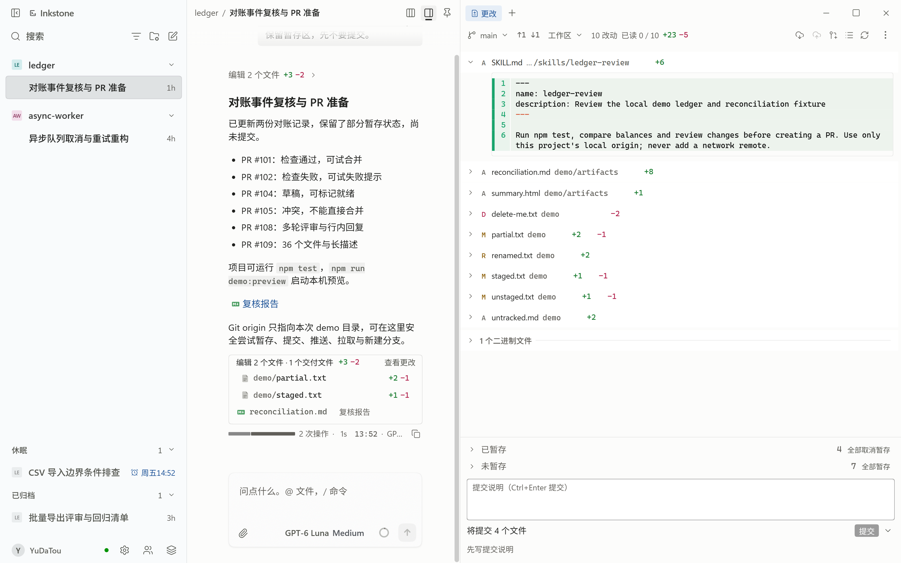

<p align="center">
  
</p>

<h1 align="center">砚 · Inkstone</h1>
<p align="center">基于 pi 的个人 AI 工作台。把代码、文件、网页和终端放在同一个会话里，让 Agent 动手，也让你看见它做了什么。</p>

<p align="center">
  <a href="https://inkstone-site.yudatou.workers.dev/">项目官网</a> ·
  <a href="https://github.com/Yu-DaTouX/Inkstone/releases/latest"><b>下载 Windows x64</b></a> ·
  <a href="https://github.com/Yu-DaTouX/Inkstone/releases/tag/v0.16.0#assets">下载 Android 测试版</a> ·
  <a href="https://github.com/Yu-DaTouX/Inkstone/releases">更新日志</a> ·
  <a href="https://github.com/Yu-DaTouX/Inkstone/issues">问题反馈</a>
</p>

<picture>
  <source media="(prefers-color-scheme: dark)" srcset="assets/inkstone/workspace-0.15.0-dark.png">
  <source media="(prefers-color-scheme: light)" srcset="assets/inkstone/workspace-0.15.0-light.png">
  
</picture>

<p align="center"><sub>桌面 0.15.0 界面示意，使用演示数据。</sub></p>

## 下载与上手

| 平台 | 从哪里下载 | 如何开始 |
| --- | --- | --- |
| Windows x64 | [桌面发布页](https://github.com/Yu-DaTouX/Inkstone/releases/latest)：安装选 `*-setup.exe`；免安装选 `*-portable.exe` 或解压 `*-portable-fast.zip`。可用同页的 `SHA256SUMS.txt` 校验下载文件。 | 在 **设置 → 模型** 登录或配置 API Key，新建会话并选好项目文件夹。 |
| Android（测试） | [桌面 0.16.0 的发布附件](https://github.com/Yu-DaTouX/Inkstone/releases/tag/v0.16.0#assets)中的 `Inkstone-mobile-0.3.3.apk` | 在电脑端 **设置 → 手机与远程** 显示配对码，用手机扫码连接。 |

Windows 安装包未签名，可能出现「未知发布者」提示，请从本仓库 Releases 下载。macOS、Linux 和 iOS 尚未交付；源码中的改动不一定已进入发布包。

## 桌面 0.17.0 有什么新变化？

- **用 Antigravity 聊天**：在主会话里选择模型和思考档，发送图片、继续长会话，也可以查看订阅额度。
- **切换本地模型**：为不同模型保存各自的启动配置；如果它们共用端口，砚会协调切换。
- **读长会话、查改动**：从小地图跳到早先的回复，或一键回到最新消息时，画面更少跳动。本轮改动卡也会列出文件变更。

[查看 0.17.0 完整更新日志](https://github.com/Yu-DaTouX/Inkstone/releases/tag/v0.17.0)。此版只发布 Windows 包，Android 测试版仍从上表单独下载。

## 你可以用它做什么

- **在项目里做事**：用 `@` 引用文件、拖入图片，用 `/` 找命令；思考与工具步骤可展开，结果可与文件、PDF、Git 差异和终端并排查看。
- **同时跟进多个任务**：按项目整理、置顶与全文搜索会话；用分屏对照不同会话，或让子 Agent 在后台分工。读长回复时，可用小地图定位。
- **在工作台内操作网页**：内置浏览器展示 Agent 正在操作的页面；需要时你可以接管。不同会话的浏览器标签分开管理。
- **从手机继续**：Android 测试版连接电脑后，可以看进度、回复、处理审批并查看更改。
- **按需要配置**：支持中文与英文界面，可切换模型和思考档位，按项目或全局配置技能、MCP，并从插件市场安装语音输入等扩展。

## 数据与权限

会话与设置保存在本机；发送给模型的数据会交给你选的模型服务，费用由该服务收取。常规操作可自动批准，危险操作和项目外写入会按权限设置确认；「不受限制」档仍会确认部分关键操作。换电脑或迁移前，建议先备份数据。提交 Issue 时请附上版本号、操作步骤，遮住密钥和私人内容。

## 与 pi 的关系

使用 pi 后端时，模型循环和工具执行由 [pi](https://github.com/badlogic/pi-mono)（`@earendil-works/pi-coding-agent`）提供，砚以独立 RPC 子进程的方式运行它，随包带一份固定版本的运行时。上下文、会话恢复、技能和 MCP 由 pi 原生管理，压缩沿用 pi 的触发与记录机制。砚在此之上提供：

- **界面**：把 pi 的工作过程呈现出来；
- **宿主能力**：审批、文件、Git、终端、浏览器等；
- **少量随包 pi 扩展**：提问、待办、危险操作审批，以及到达自动压缩上限时调用原生 `compact()`。压缩摘要由砚通过 pi 的 `session_before_compact` 钩子生成，并保留原文快照；不改写正常请求中的历史消息。宿主侧另有可关闭的流式循环防护。

`yan` 命令行（`resources/yan-cli/`）给 Agent 提供砚的能力，例如子 Agent、搜索、技能接入。

<details>
<summary>开发者：从源码运行</summary>

技术栈：Electron、React、TypeScript；手机端在 `mobile/`（React Native）。

准备 Git、Node.js（建议 24）和 npm，然后在 PowerShell 中执行：

```powershell
git clone https://github.com/Yu-DaTouX/Inkstone.git
cd Inkstone
npm install -g @earendil-works/pi-coding-agent
npm run launch
```

启动器会检查依赖，准备缺失的内置 pi 运行时（从已安装的 pi 提取），并按需构建。已有工作区可以直接双击 `启动-砚.cmd`。

常用命令：

| 命令 | 作用 |
| --- | --- |
| `npm run launch:dev` / `开发-砚.cmd` | 开发模式启动 |
| `npm run dev` | electron-vite 开发服务器 |
| `npm run build` | 构建到 `out/` |
| `npm run typecheck` | 主进程与渲染端类型检查、CSS 与分层检查 |
| `npm run test:unit` | 完整单元测试（依赖已构建的 `out/`） |
| `npm run test:unit -- queue agents-doc` | 按文件名前缀运行独立套件；加 `--list` 只看清单。未迁移套件明确报错，不会退回全量执行 |
| `npm run test:live -- <场景>` | Electron 场景检查；部分场景会请求真实模型，按场景选择 |
| `npm run check` | 完整检查（类型、图标、构建、单测、设计度量、核心 live 场景） |
| `npm run vendor:pi` / `npm run upgrade:pi` | 提取或升级随包 pi 运行时 |
| `npm run debug -- help` | 隔离实例、假模型、截图与回归场景 |
| `npm run storybook` | 界面控件的 Storybook |
| `npm run dist` | 打包 Windows 安装包 |

目录概览：

| 位置 | 内容 |
| --- | --- |
| `src/main/` | Electron 主进程：pi 进程管理、审批、文件、Git、终端、远程连接 |
| `src/preload/` | 渲染端可调用的宿主接口 |
| `src/renderer/src/` | 界面：`app/` 外壳，`features/` 各功能，`ui/` 基础控件，`design/tokens.json` 设计令牌 |
| `src/shared/` | 主进程与渲染端共用的类型和纯逻辑 |
| `resources/` | 随包的 pi 扩展、技能、`yan` CLI、品牌素材；`pi-runtime/` 由脚本生成，不进 Git |
| `scripts/` | 构建、测试、打包与设计检查脚本 |
| `mobile/` | Android 客户端（React Native） |
| `integrations/hermes-inkstone/` | Hermes 外部控制插件 |
| `integrations/desktop-pet/`、`integrations/comfyui/` | 随包插件：桌宠、ComfyUI 本地出图，在插件市场安装 |

AI 协作约定见 [AGENTS.md](AGENTS.md)。

</details>

## 许可证

[MIT](LICENSE) · © 2026 Yu-DaTouX。第三方组件的许可见[第三方许可](THIRD-PARTY.md)。
