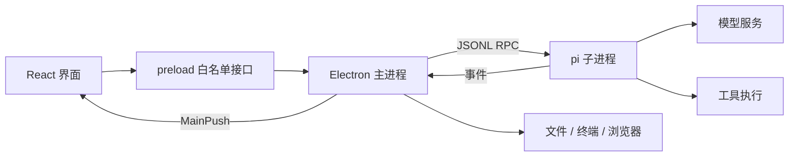

# Inkstone 架构简介

产品目标见[产品方向](PRODUCT_DIRECTION.md)：以 pi 会话与指定模型子 Agent 为核心，桌面目标为 Windows/macOS/Linux，Android/iOS 远程连接电脑。下文为当前源码结构，未完成的平台和精简项不视为已交付。

Inkstone 使用 Electron、React 和 TypeScript，通过独立 pi 子进程完成模型循环与工具执行。

独立运行与普通文件任务属于待精简复核的既有实现，不作为未来所有会话必须经过的架构。普通文件任务另由 `src/core/agent-service.ts` 保存任务、审批、预算与成果事实，桌面 IPC 和 `src/adapters/service-cli.ts` 复用同一服务。独立 Node 入口显式选择运行时、模型和数据目录；官方 pi 仍拥有消息、历史与压缩。现有桌面会话、多 Agent 工作台和外部 CLI 保留原后端，Android 通过已有协议协商能力。详见[运行服务](AGENT_SERVICE.md)。

## 职责

- **渲染进程**：会话与项目界面、输入、内容展示和用户操作；通过 preload 使用宿主能力。
- **preload 与共享契约**：限制可调用入口，维护跨进程类型和事件结构。
- **主进程**：会话生命周期、pi RPC、文件和终端、浏览器表面及配置持久化。
- **pi**：模型循环、上下文与工具执行；随包适配位于 `resources/`。

压缩、恢复、技能与项目规则由 pi 原生执行，其他 CLI Agent 使用自己的机制。砚展示用量与压缩状态，手动压缩直接走 pi RPC；随包 `context-trim.js` 另提供两项可配置的轻量适配：

- **旧工具输出裁剪**：默认软线 80k token，小窗口不超过窗口的 30%；先规划候选批次，再按收益门槛省略较早的大段工具结果。通常保留最近三轮；旧轮裁过后仍超过硬线（软线的 1.5 倍），也允许裁近期长轮的旧工具组，但每个用户轮最近三组始终保留（同一 assistant 的并行调用算一组）。技能读取、错误结果和未完成的工具组不裁。用最近成功请求记录的节省量校准原生用量，避免重复扣减；原生投影编辑、压缩与会话切换时使过期记录失效。只改本次请求视图，不改会话文件、界面历史或压缩输入，不生成摘要、不提供自动召回。
- **自动压缩上限**：默认 250k token，小窗口不超过窗口的 90%；整轮结束后达到条件时调用 pi 原生 `compact()`，跟随 pi 自动压缩开关，不取代 pi 自身的保底机制。

缓存保护以不改已有前缀为优先：新批次预估节省至少达到软线的 25% 和当前发送量的 20% 才提交，否则保留候选原文与既有存根，等待更多可裁结果积累。5 分钟空闲仅作为冷热启发式，不是服务商 TTL，超过间隔也不跳过收益门槛。发送量达到已知模型窗口的 80% 时，容量优先，可突破批次收益门槛，但仍保护技能、错误、未完成及近期工具组；无法裁掉的内容仍交由 pi 原生压缩处理。提交新批次本身仍可能使缓存失效，后续复用不保证服务端命中。

设置入口为「会话 → 上下文与记忆」，实际参数见 `src/shared/context-limits.ts`。这两项不恢复旧宿主工作集预算、知识自动注入、自动交接或续跑；资料仍由用户主动发送或 Agent 自己读取。裁剪可能影响前缀缓存，不保证每轮费用都更低。

随包薄层不注册模型工具，仅有一个例外：Windows 上 `shell-fallback.js` 用 pi 自己的定义同名覆盖内置 `bash`，工具名、参数与输出不变，只替换执行方式：命令经临时文件交给 Git Bash（`bash -c` 传参会把成对反斜杠减半、超 8186 字符截断），控制台切到 UTF-8，并让 `python` 绕过商店安装引导。模型、审批与会话看到的仍是原命令；pi 上游修复交付方式后应撤掉这层覆盖。

pi 0.99 及以上的 MCP、codemode 与工具搜索使用原生内置扩展。宿主的共享浏览器、电脑操作与授权协调继续经过砚的能力入口；旧宿主 MCP 配置保留兼容，新配置优先使用 pi 的 `mcp.json`，不把受管设备服务自动迁移到另一套权限边界。

## 数据与运行边界

本地设置和会话由应用与 pi 持久化；连接远程模型时，请求发送至所选服务。数据位置见 [发布与备份](dev/RELEASING.md#数据位置与备份)。应用的本地档案不等于模型账号登录。

Electron 网页表面与 React DOM 分属不同层，浏览器浮层、窗口缩放和焦点切换需要在宿主与界面间协调。切换会话时应明确各事件所属的会话，避免后台事件覆盖当前会话状态。

消息内的 HTML 成果不复用带宿主桥接的主页面：主进程只为受控成果目录内不超过 5 MiB 的完整文件建立随机令牌快照，经 `inkstone-html:` 独立协议交给无同源权限的 sandbox iframe。独立响应头 CSP 允许内联脚本与样式，但禁止联网、其他文件、子网页和表单；主窗口不放宽 `script-src`，IPC 同时校验主窗口及其 main frame。预览卸载即释放，主窗口重载、崩溃或销毁清空快照；并发读取与活跃预览合计最多 16 个。普通 Markdown 与代码块不作为网页执行。

具体文件入口见 [代码导览](PROJECT.md) 和 [按功能查找的代码地图](CODE_MAP.md)。语言、桌面壳与手机客户端的取舍见 [技术路线评估](TECH_STACK_OPTIONS.md)。接口以源码为准，本页不记录内部排期或阶段验收结论。
