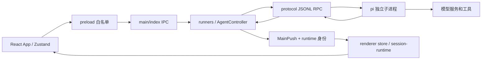

# Inkstone 代码地图

目标与现状分开维护：[产品方向](PRODUCT_DIRECTION.md)定义轻量客户端及精简范围；本页记录现有调用链，不授权继续扩建旧模块。

[文档索引](README.md) · [代码导览](PROJECT.md) · [架构简介](ARCHITECTURE.md) · [技术路线](TECH_STACK_OPTIONS.md)

面向维护者与接手任务的 Agent。本页按**要改什么**定位源码；目录所有权与更多功能文件见 [PROJECT.md](PROJECT.md)。以当前源码为准，修改前先看 `git status --short` 和目标文件；不要把生成物、发行目录或本机内部资料当作源码。以下是 2026-10-01 按当前工作区源码更新的静态导航，不代表各功能已完成运行验证。

接手任务时按这条顺序查：**用户操作 → preload/IPC 或远程入口 → 宿主服务与 pi RPC → 持久记录 → 运行事件与渲染投影**。先确认当前请求需要哪个平台、在哪台设备执行；跨端方案同时看 [技术路线](TECH_STACK_OPTIONS.md)，按个人开发者可维护的首版范围收敛。未在地图中列出的文件用 `rg --files` / `rg` 定位，不能因地图没有列出就断言能力不存在。

## 一条消息经过哪里

| 环节 | 先读文件 | 改动时留意 |
| --- | --- | --- |
| 桌面启动与装配 | `src/main/index.ts`、`src/main/paths.ts`、`src/main/settings.ts` | `index.ts` 负责装配与生命周期：建存储与服务、启动 pi、创建窗口，并在启动前把宿主能力接到各服务（`configureGoalCoordinator` / `configureHandoffCoordinator` / `configureRemoteHost`）；发送 / 中止等运行控制与窗口类 IPC 仍在入口，不要把业务判断再复制到新入口。设置在 `patchSettings` 写盘失败时**如实抛错、不更新缓存**；读盘/解析失败拒绝覆盖，读写共用清洗，普通渲染补丁经字段白名单（不能修改 `piBin` / `guardAllowRoots`），读改写由 `updateSettings` 串行执行（旧行为是只打日志并返回新设置，界面会显示“已保存”而重启后变回旧值） |
| pi 进程与协议 | `src/main/protocol.ts`、`src/main/agent.ts` | pi 通过独立 JSONL RPC 子进程运行；`protocol.ts` 使用 Electron 自带 Node 和 `--mode rpc` |
| 并发会话与空闲回收 | `src/main/runners.ts`、`runner-reclaim.ts`、`src/main/agent.ts`、`src/main/index.ts` | `runnerId/runId`、`sessionId`、`generation` 含义不同；切换视图不能停掉仍在跑的会话。每60秒扫描、每轮最多回收一个持续空闲10分钟的非活动实例；要求已保存、连接就绪、无队列/提问/bash、同cwd无人忙、非隐藏/重载、非显示中会话。首版保守保护有子代理归属（含已结束历史）的父会话，显式清除归属后才解除。选择、重载与回收共用串行链，关闭后沿原选择路径载回JSONL；定向检查 `scripts/test-runner-reclaim.mjs` / `test-runner-reclaim-live.mjs` |
| 宿主接口 | `src/shared/ipc.ts` → `src/preload/index.ts` → `src/main/ipc/<领域>-ipc.ts`（经 `ipc/registrar.ts` 注册） | 按领域的注册器：会话、目标 / 模式 / 交接、空间与档案、资料、来源、文件、Git、插件包、能力、长期记忆、任务收件箱、旧上下文接口兼容、子代理、砚对砚、同意记录、模型接入等；依赖经参数显式传入。新增能力核对类型、白名单与处理器；注册器统一校验调用者是主窗口 |
| 推送到界面 | `src/main/index.ts` 的 `pushFrom`、`src/shared/ipc.ts` 的 `MainPush`、`src/renderer/src/state/store.ts` 的 `applyPush` | 身份与归属判定在 `state/push-routing.ts`（纯函数，`scripts/test-push-routing.mjs`）：旧代次丢弃、后台会话只进 `state/session-runtime.ts` 缓存；窗口 / 提问与通知 / 子代理 / 任务状态由 `state/push-consumers.ts` 分别消费，会话与消息的核心投影在 store；`src/main/ui-requests.ts` 的宿主提问超时推 `ui-resolved`，同时移除面板与会话缓存，定向检查 `scripts/test-question-timeout.mjs` |
| 用户看到的对话 | `src/renderer/src/App.tsx`、`components/chat/TurnView.tsx`、`TurnProcess.tsx`（活动行与过程树）、`run-status.ts`（运行阶段与计时）、`MessageParts.tsx`、`Composer.tsx`；界面方案样式在 `styles/scheme.css` | 消息是历史与运行事件的投影；草稿、队列和流式状态另有归属；过程放正文后还是右侧由设置 `processLayout` 与容器宽度决定。工具调用行在 `components/chat/ToolRow.tsx`，展开的详情统一走 `ToolCallDetail.tsx`（行内与宽幅阅读共用一份已记录内容，不重跑工具）：命令给终端、文件改动给红绿 diff、其余给结果；增删行数只取执行前后快照（`src/main/snapshots.ts`），拿不到就不写。导航轨 `ConversationOutline.tsx` 经 `src/shared/outline-turns.ts` 复用历史回合与摘要引用，几何匹配使用消息ID索引；只读分屏轨不订阅焦点会话消息变化，检查见 `scripts/test-outline-turns.mjs` / `test-outline-performance.mjs` |

## 按问题找代码

模型错误的分类、原文脱敏与提示集中于 `src/shared/model-errors.ts`，实时消息、历史读回和子 Agent 共用；宿主自动续跑的规划与存储源码已退役，不再读取旧自动续跑配置。

| 任务或症状 | 主要入口 | 相邻契约与状态 |
| --- | --- | --- |
| 会话创建、切换、历史或标题 | `src/main/runners.ts`、`sessions.ts`、`session-reader.ts`、`session-history.ts`、`title.ts` | `src/main/agent.ts`、`src/renderer/src/state/store.ts`、`src/shared/ipc.ts`；持久会话记录以 pi JSONL 为准。历史读文件走 `session-reader.ts`（64 KiB 分块 + `StringDecoder`、单行 48 MiB 上限、坏行跳过）→ `normalize.ts` 的 `createHistoryBuilder` 逐条归一化；同一文件同一版本的 peek/hydrate/远程历史并发读取单飞共享，返回深冻结快照（修改方先复制），读完即释放、不做常驻缓存，读取前后核对身份与版本，被替换或截短只重读一次；对应 `scripts/test-session-read-equivalence.mjs`、`scripts/test-session-reader-stream.mjs`。历史切换、新建、fork、clone 及托盘切换共用 `store.ts` 的**选择代次**决定归属：历史点击与托盘无路径选择共用代次，过期的 peek 不写投影、不再请求主进程激活，过期的托盘响应也不覆盖新选择；定向回归见 `scripts/test-session-switch.mjs` |
| 分屏（多会话磁贴） | `src/renderer/src/lib/use-runner-visibility.ts`（经 preload `setVisibleRunnerSessions` 将显示中的会话ID/路径同步给宿主；未知/重载/崩溃期间不回收）、`src/renderer/src/state/split-view.ts`（`tiles` + `live` 与纯函数）、`split-drop.ts`（左栏拖入落点）、`split-snapshots.ts`（失焦块的消息与滚动快照）、`resource-owners.ts`（终端与文件预览归属哪条会话）、`workspace-key.ts`（单会话与分屏每列共用的工作区键；磁贴另有固定编号 `uid`）、`components/chat/SplitPeerPane.tsx`、`SplitResizer.tsx` | 版面与交互规则在 `docs/DESIGN_SYSTEM.md` §4 分屏段；检查 `scripts/test-split-view.mjs`、`scripts/probe/split-*.js` |
| 后台 Agent、队列、停止与继续 | `src/main/session-work-scheduler.ts`（回合收尾观察）、`goal-coordinator.ts`（工作模式、活动档案和目标状态）、`src/main/runners.ts`、`goal-service.ts` | `src/main/agent.ts` 的事件、发送和原生队列；`src/shared/goal.ts`、`src/renderer/src/state/session-runtime.ts`。宿主自动错误重试、目标续跑与自动交接均停用；`scripts/test-queue-rpc-live.mjs` 使用真实随包pi与本机模型夹具验证队列编辑/中止交错、回收与正常消费 |
| 子 Agent、隔离工作区与交接 | `components/workbench/AgentWorkspacePanel.tsx`（统一入口与运行标签）、`src/shared/agent-workspace.ts`（只读投影）、`src/main/subagent-service.ts`（`yan subagent` 共用的控制器）、`subagents.ts`、`subagent-history.ts`（纯快照保存/恢复与旧原生会话兼容，不复活运行）、`subagent-isolation.ts`、`session-isolation.ts`、`handoff-coordinator.ts`（历史交接兼容，自动判资格入口停用）、`handoff-service.ts`、`handoff-transaction-service.ts` | `src/shared/subagent-brief.ts`、`subagent-usage.ts`、`handoff.ts`、`handoff-transaction.ts`；聊天卡片 `components/chat/SubagentCards.tsx` 展示权限范围、模型、思考、原生上下文快照及耗时，`subagents.ts` 在助手消息结束时读取 pi `get_session_stats`（不轮询、不用累计 token 冒充上下文）；助手流式更新的快照按运行合并为33ms一次，并按上一次推送的转录形状只发改动的那一段（`subagent-patch`，形状对不上时退回整条），工具、消息结束与生命周期状态即时推送，主动读取不等待合并；缺补丁或非待审阅状态拒绝合并并保留工作区，退出等待 settled 转录收尾与 RPC 关闭；对应 `scripts/test-subagent-stream-performance.mjs`、`scripts/test-review-host.mjs`；`store.ts` 启动时加载子代理历史，`AgentMessageStream.tsx` 只显示过程，不再设任务原文按钮；`scripts/test-handoff-host-regression.mjs` 从 `handoff-coordinator.ts` 取函数驱动 |
| Agent 原生上下文与历史召回 | `src/shared/agent-context.ts`、`src/main/agent.ts`、`src/main/compaction.ts` | 原生 pi RPC 执行压缩与恢复；`NativeContextSection.tsx` 显示原生用量，`NativeContextTab.tsx` 提供直接操作及裁剪/压缩阈值设置。`resources/pi-extensions/context-trim.js` 裁剪旧工具输出请求视图并在整轮结束后触发原生压缩，档位由 `src/shared/context-limits.ts` 对齐，边界见[架构简介](ARCHITECTURE.md#职责)。旧工作集预算、项目知识自动注入、目标续行与交接扩展已退出默认流程；旧预算 IPC 拒绝修改，历史资料保留，`context-recall.ts` 提供主动归档回读。`pi-runtime-location.ts` 选择 runtime generation；`scripts/vendor-pi.mjs` 保留官方 Codemode 的 QuickJS WASM / worker，`scripts/lib/pi-upgrade-policy.mjs` 阻止隐式降级；`scripts/test-agent-native-context.mjs` 检查退役边界 |
| 扩展命令、模型能力与工具接入 | `resources/pi-extensions/`、`src/main/capabilities/`（`acquisition-commands.ts`：`yan capabilities` 检索 / 发现 / 计划 / 接入）、`src/main/mcp/` | `src/main/agent.ts` 的 `runCapabilityCommand` 分派，其余宿主工具在 `browser-commands.ts`、`lookup-commands.ts`（`yan search` / `yan knowledge`）；`src/main/extensions-inventory.ts`、`resources/yan-cli/yan.mjs`；宿主能力优先放宿主，pi 扩展保持薄 |
| 本机远程管理入口 | `src/main/remote-server.ts`、`src/main/remote-host.ts`（会话摘要、历史、有限会话操作与砚对砚开放数据；与桌面会话 IPC 共用 `session-host.ts`）、`src/main/remote-devices.ts`（配对码与设备表）、`src/main/index.ts` 的 `startRemoteServer` | 显式命令白名单与事件筛选；手机设备配对即可访问；配对校验-消费-设备表落盘在同一串行队列（并发下也只能用一次），设备表写盘失败可恢复、撤销以落盘成功为准 |
| Hermes 人工批准 | `integrations/hermes-inkstone/approvals.py` 用户命令 → `remote-server.ts` 的 `/questions/:id/approval` → `remote-host.ts` → `remote-approval.ts` → `ApprovalBroker` / 敏感 UI 请求 | 单独配对的用户客户端；绑定会话、运行、完整内容摘要与有效期，幂等回传一次决定；模型工具不注册批准动作，普通 `answer` 不能放行 |
| 插件市场 | `components/settings/PluginMarketTab.tsx` → preload `packages` → `ipc/packages-ipc.ts` → `plugin-market.ts` / `packages.ts` | 砚页导出随包 Hermes，pi 页只读 npm pi-package 目录，安装仍走 pi 原生 CLI；自有条目在 `shared/inkstone-plugins.ts`，资源分发在 `electron-builder.yml` |
| 砚对砚互通 | 所有者侧：`src/main/peer-grants.ts`（本次连接授权）、`remote-server.ts` 的 `handlePeer`、`remote-host.ts` 的 `peerHostHandlers`、`ipc/peer-host-ipc.ts`、`components/shell/PeerApprovalDialog.tsx`；连接者侧：`src/main/peer-client.ts`、`ipc/peer-ipc.ts`、`components/settings/PeerTab.tsx` | `src/shared/peer-protocol.ts`；peer 令牌只进 `/remote/v1/peer/*`，授权绑定事件流、断开即失效；`scripts/test-peer.mjs` 钉住门禁 |
| 项目目录信任与撤销 | `project-trust.ts` → `ipc/workspace-ipc.ts` → preload `trust.allow/revoke` → `EnvironmentMenu.tsx` | 目录先 realpath/stat；坏 trust.json 拒绝覆盖，串行临时同步写；撤销显式写 false 阻断父目录继承，仅后续加载生效，不卸载正在运行的扩展 |
| 更改项目文件夹 | `components/rail/ProjectDirectoryDialog.tsx` → preload `changeProjectDirectory` → `ipc/workspace-ipc.ts` → `project-directory.ts` → `settings.ts` 的串行更新 | 保留项目 ID、名称和已有会话归属，不改历史 cwd、不搬文件或切换 runner；校验目标目录、目录链接占用和陈旧请求，清理旧路径名称/最近目录映射避免重建旧项目。`file-context.ts` 只允许宿主同项目实例继续访问旧 cwd。定向检查 `scripts/test-project-directory.mjs`；纯合成场景 `test:live projectdirectory`。不全量补迁未索引历史 |
| 项目、工作树、Git 状态 | `src/main/session-layout.ts`、`project-id.ts`、`git-service.ts`、`git-worktree.ts`、`git-actions.ts` | `src/renderer/src/components/rail/`（`Rail.tsx` 主体、`useRailDrag` 拖拽、`useRailProjects` 项目数据、`RailViewMenu` 视图菜单）、`components/review/`、`src/shared/git.ts` |
| 内置浏览器与 Chrome | `src/main/browser.ts`、`src/main/browser/`、`src/main/chrome.ts` | `components/browser/BrowserSurface.tsx`；网页是原生 `WebContentsView`，位置、缩放与焦点由主进程协调 |
| 多 Agent 工作台 | `src/shared/agent-hub.ts`、`src/main/agent-hub/service.ts`、`resources/yan-cli/hub-mcp.mjs` | 桌面 `AgentWorkspacePanel.tsx` 汇总子 pi 与 Hub 运行，`components/workbench/AgentHubPanel.tsx` 展示 Hub 详情 → preload / `ipc/agent-hub-ipc.ts` → 任务服务 → Codex app-server / Claude stream-json / pi RPC / PTY；`workspaces.ts` 冻结与重建成果，`resources.ts` 协调浏览器与 Windows 输入；手机 `mobile/src/screens/AgentHubScreen.tsx` 经 `remote-server.ts` 接同一服务 |
| 原生虚拟模型与实际回复模型 | `src/shared/turns.ts`、`components/chat/TurnProcess.tsx`、`components/toolbar/NativeContextSection.tsx` | 选择/路由仍归 pi；回复尾部取持久助手的实际模型，窗口优先匹配原生事实；`shared/model-capabilities.ts` 的模型归一化保留原生 API 身份；子模型启动前 `src/main/subagents/registered-model.ts` 原生注册及来源 API 核对，经 `index.ts` / `subagent-service.ts` 接线。`test:live -- bundlereal` 是需授权的固定 DeepSeek Flash 真实链路，`arrivaldom` 只注入渲染快照 |
| 旧通用 MCP 导入 pi | `components/settings/McpNativeImport.tsx` / `mcp-native-import-flow.ts` → preload `capabilities.prepareNativeImport/commitNativeImport` → `ipc/capabilities-ipc.ts` → `mcp/native-import.ts` / `native-verify.ts` | `shared/mcp-native-import.ts`；主窗口及 runner/generation/project 绑定，指纹限定批准内容，单条隔离 CLI 校验；写原生、校验、停旧三步分开，authRef 不搬，windows-mcp 保留；`mcp/config.ts` 的迁移提示与 snapshot 标记 |
| 终端报告与 Windows 任务栏 | `src/main/terminal-status.ts`、`terminal.ts`、`index.ts` 的 `refreshTaskbar/notifyBlockedTerminal` | OSC 7501 主记录优先、9;4 后备；`push-consumers.ts` 只收低频 status，`lib/terminal-tab-status.ts` → `RightPanel.tsx` / `Workspace.tsx` 页签徽标；未上报不算忙，退出与关闭清归属；Windows 自建 PTY 原生报告环境开关 |
| 确认框与图标提示 | `components/ui/confirm.tsx` / `confirm-queue.ts`、`Tip.tsx`、`lib/tip-scheduler.ts` | App 一处串行确认，卸载/范围变化取消；Tip 的 DOM id 与调度 owner 分离，非模态、仅提示可见期阻挡原生视图，键盘 Esc 只关闭当前提示 |
| 终端、文件与附件 | `src/main/terminal.ts`、`files.ts`、`attachments.ts`、`file-refs.ts` | `components/chat/Terminal.tsx`、`components/terminal/TerminalSurface.tsx`、`components/toolbar/FilePreview.tsx`；终端依赖 `node-pty`，壳/cwd 启动失败不永久禁用模块；文件树与文本/办公预览的 cwd 共用 `index.ts` / `file-context.ts` 的已授权项目或会话目录核对，绝对文件预览仍遵循 `file-refs.ts` 原有边界 |
| 随包技能（领域做法按需加载） | `resources/skills/<名称>/SKILL.md`（默认加载 office、subagent、playbook、capabilities、doc-sync、organize、visual-answer，目录下有几个就加载几个；tutor、writing、research、follow、memory 已于 2026-10-13 删除）；用户技能在 `YAN_DIR/skills`（`src/main/user-skills.ts`）（打包到 resources/yan-skills）、`src/main/index.ts` 的 `bundledSkillPaths` | `AgentController` 以 `--skill` 显式传入随包和用户技能，同时允许 pi 原生技能发现；领域流程优先写成技能，宿主只保留技能做不到的部分（真实文件预览、授权、持久数据） |
| 办公文件预览（docx / xlsx / pptx / pdf） | `src/main/office/`（`zip.ts`、`extract.ts`、`office-service.ts`、`worker.ts`）、`src/main/ipc/office-ipc.ts` | 路径校验后在独立 worker 读取/解析（并发2、30秒超时）；ZIP 单条目8MiB/累计16MiB，正文最多5000行/512Ki字符。`src/shared/office.ts`（预览类型）、`components/review/OfficeContent.tsx`（文件文字预览）、`yan office read`（`src/main/agent.ts` 的 `office.read`）；只提取文字，不还原版式 |
| 应用更新与对话内文件链接 | `src/main/app-update.ts`（GitHub Release 检查；安装版经 electron-updater 下载，便携版 / 开发版只给手动入口；有任务运行时拒绝重启安装）、`index.ts` 的 `yan:openFileDefault` / `shared/document-open.ts`（只直接打开白名单文档与被动图片；代码、SVG、快捷方式及未知类型只定位，网络路径拒绝）、`search/opencli.ts` 的 `installOpenCli`（设置页显式点击才执行 npm 全局安装） | `components/settings/AppUpdateSection.tsx`、`src/shared/app-update.ts`；更新未做真实安装升级验证 |
| 电脑本地语音输入（whisper.cpp） | `src/main/voice/voice-service.ts`、`src/main/ipc/voice-ipc.ts` | `src/shared/voice-input.ts`（模型目录、按配置推荐、WAV 编码、输出解析）、`components/chat/VoiceInputButton.tsx`（录音 → 转写 → 插入输入框）、`components/settings/VoiceTab.tsx`；下载先 `plan` 核实大小与位置，用户确认后才 `download`；录音只存临时文件 |
| 检查点与回退代码 | `src/main/checkpoints.ts`（影子 git 仓库：发送前快照、预览、恢复、撤销、30 天清理）、`ipc/checkpoint-ipc.ts` 与 `workspace-mutation.ts`（回退前预占项目门闩并核对同 cwd 运行/等待/排队；`agent.ts` 在发送/插话/排队入闸时拒绝回退中的写入）；`index.ts` 的 `yan:send` 在新一轮前调用 | `src/shared/checkpoints.ts`（类型与消息匹配）、`components/shell/RewindDialog.tsx`、`TurnView.tsx` 的「回退代码」；`scripts/test-checkpoints.mjs` 用真 git 在临时目录验证 |
| 会话切换器与正文检索 | `src/main/session-search.ts`（会话 JSONL 的内存索引与检索）、`ipc/session-ipc.ts` 的 `yan:searchSessions` | `src/shared/session-search-text.ts`（取文字、拆词、片段）、`components/shell/SessionSwitcher.tsx`（Ctrl+K，`>` 动作模式）、`lib/host-actions.ts` / `use-host-actions.ts`（同源动作/键位/可用性）、`ShortcutSheet.tsx`（Ctrl+/）、`lib/composer-submit.ts`（与输入框共用 slash 正式路径）；`App.tsx` 接键，终端/模态/IME 持有时不抢新增快捷键 |
| 写入项目之外前确认 | `resources/pi-extensions/danger-guard.js` 的 `outsideWrites`（读 `desktop.json` 的 `guardOutsideWrites` / `guardAllowRoots`）、`index.ts` 的 `confirmDanger`（可「允许并记住目录」） | 设置在 `components/settings/CapabilitiesTab.tsx`；`scripts/test-danger-guard.mjs` |
| 单轮重复动作兜底 | `resources/pi-extensions/repeat-guard.js`（`tool_call` 钩子：同一工具 + 规范化参数逐字相同 + 连续，第 3 次提醒、第 5 次拦下；另拦 sleep 轮询子代理）、`src/main/index.ts` 的 `repeatGuardExtensionPath` | 拦下计数写 `<YAN_DATA_DIR>/repeat-guard/`，宿主侧 `shared/repeat-guard.ts` / `goal-service.ts` 读取；用例 `scripts/test-repeat-guard.mjs`，真实接线 `test:live repeatguardlive` |
| 普通工具的自动调用依据 | `src/shared/tool-consent.ts`（键、危险类别、衰减与 Wilson 下界判定）、`src/main/consent-store.ts` | `src/main/agent.ts` 的 `consent.request`（`yan consent request`）、`index.ts` 的确认框、`ipc/consent-ipc.ts`、设置页 `ConsentSection.tsx` 已移除、无界面入口（store 与 IPC 仅历史数据兼容）；只记录确认框里的真实答复，危险类别与远程场景永远询问；另有**高危操作确认**：`resources/pi-extensions/danger-guard.js`（`tool_call` 钩子，命中大范围删除 / 强推 / 丢弃改动等才向宿主发 `danger.confirm`，宿主每次弹框、不记忆；是提醒式护栏不是沙箱，命中却无法确认时拦下）+ `agent.ts` 的 `runDangerConfirmCommand`、`index.ts` 的 `confirmDanger`，判定用例 `scripts/test-danger-guard.mjs` |
| 模型登录、凭证、设置 | `src/main/oauth.ts`（ChatGPT）、`oauth-providers.ts`（Claude / Copilot / xAI / OpenRouter，驱动随包 pi 的登录模块）、`credentials.ts`、`custom-providers.ts`、`settings.ts` | `components/settings/AuthTab.tsx`（登录/API Key/自定义服务分区）、`SettingsSections.tsx`（同页按需挂载、隐藏保留草稿）、`Settings.tsx`（导航与旧深链接）、`src/shared/model-capabilities.ts`；外置依赖入口见 `ClaudeSubscriptionSection.tsx`、`CapabilitiesTab.tsx` 与[插件市场](PLUGIN_MARKET.md)。本地档案不代表模型账号已登录。**auth.json 的所有写入（合并一条、退出登录、切换账号）统一走 `credentials.ts` 的持锁读改写**，与 pi 同一把 `auth.json.lock` 并会刷新 mtime |
| 模型能否思考、单模型协议 | `src/shared/custom-provider.ts` 的 `describeDiscoveredModels`（端点给的 `supported_endpoints` / `context_length` + 按模型 ID 查 pi 自带目录）、`resources/pi-extensions/generated/pi-model-catalog.json`（`scripts/gen-pi-model-catalog.mjs` 生成） | 自定义服务的「获取模型列表」走 `custom-providers.ts`；pi 不认识的 Command Code 由 `resources/pi-extensions/commandcode.js` 注册（凭证页填了密钥、且 models.json 没手写时），它用的是同一套逻辑的生成物 `generated/model-capabilities.mjs`（`scripts/build-model-capabilities.mjs`）；只有「关」一档时 `Pickers.tsx` 说明原因 |
| 生图通道、本机模型探测 | `src/main/image-generation.ts`（codex / openai / compatible / google / doubao / local / mock 适配与 auto 顺序）、`image-credentials.ts`（砚内 ChatGPT 登录在 auth.json 锁内刷新，`~/.codex` 只读后备；各家 key 先 auth.json 后环境变量）、`local-models.ts`（按接口特征探测常见端口与设置里添加的地址：OpenAI 兼容对话服务、SD WebUI 系、ComfyUI；未运行时按各平台常见安装位置识别；额外地址存 `YAN_DIR/local-models.json`）、`comfy-launcher.ts`（已安装未运行的 ComfyUI 按需用安装目录自带 Python 启动，空闲自动关、只关砚拉起的进程；`yan image local status|start|stop`）、`comfy-workflow.ts`（套用 ComfyUI 已保存的工作流：界面格式含子图、API 格式）、`codex-token.ts` | `yan image generate` → `agent.ts` 的 `runImageCommand`（发往第三方前先确认，探测前固定消息/会话归属并登记取消控制器；停止/实例关闭取消请求并抑制迟到成果）；参考图校验允许根与目标的真实路径；compatible 使用自身默认模型，须显式设置 `YAN_IMAGE_API_BASE` 与专用 `YAN_IMAGE_API_KEY`，不回退到 OpenAI 凭证；ComfyUI 取消只撤销本次 prompt_id 的排队项，不全局中断已运行工作流。专项 `scripts/test-image-generation-boundaries.mjs`；设置页 `CustomProviderForm.tsx` 的「检测本地模型」只把对话服务填进表单，保存仍走 `custom-providers.ts` |
| 电脑操作（Computer use） | `src/main/computer-use.ts`（检测 / 安装 uv，开关时改宿主 `mcp-servers.json` 中的 `windows-mcp` 条目，只开放界面操作工具）、`ipc/capabilities-ipc.ts` 的 `yan:computerUse:*`、`runners.ts` 的 `reloadMcpServers` | `components/settings/ComputerUseSection.tsx`（能力与插件页）；Python 与 windows-mcp 由用户的 uv 下载，不随包 |
| 品牌资产与启动画面 | `scripts/build-icon.mjs`（ICO / PNG / 托盘深浅字形）、`scripts/build-installer-sidebar.mjs`、`mobile/scripts/build-launcher-icons.mjs` 与 `sync-brand.mjs`；托盘按系统任务栏深浅切换在 `src/main/index.ts` 的 `trayImage` | 启动画面：`src/renderer/index.html` 的 `#boot` + `public/boot-theme.js`、`lib/boot-splash.ts`（App 在设置、会话、pi 连接有结论后撤）；手机 `motion.tsx` 的 `BootSplash` 与 `res/values-v31/styles.xml` |
| 主题空间与资料 | `src/main/space-store.ts`、`library-*`；旧学习记录导出在 `learning-export.ts`（当前无调用点） | 对应 `src/shared/space.ts`、`library.ts`；空间与资料库界面已于 2026-10-09 移除，`components/workbench/` 中已无对应组件，以上 store 与导出仅历史数据兼容、无界面入口；PDF 内容流解压有单流 / 累计输出预算，超限的流跳过并在 note 说明；三个 Store（空间 / 资料库 / 活动档案）落盘失败时会把内存恢复到磁盘上的真实内容，不会把失败的操作留到下一次保存 |
| 成果、文件引用与预览 | `src/main/artifacts.ts`（按会话的成果 manifest）、`src/renderer/src/state/source-files.ts`（文件来源登记）、`src/shared/file-url.ts`（本地路径 → `file://`） | 成果 manifest 的「读 → 加 → 写」在同一主进程内按真实成果目录跨 store 实例串行化并原子替换，空闲后释放队列，生成与 attach 并发不互相覆盖（不是跨进程文件锁）；产物路径与恢复校验按真实目录处理联接别名；文件来源登记必须按会话读写（在 B 会话加文件不能清掉 A 会话的记录，读侧也要按会话过滤）；本地路径逐段转义（`#` / `?` / `%` 是 URL 语法字符，不能整串 `encodeURI`） |
| 消息内 HTML 成果 | `components/chat/TurnView.tsx` → `HtmlArtifactPreview.tsx` → `preload/index.ts` / `ipc/files-ipc.ts` → `src/main/html-artifact-preview-store.ts` 与 `html-artifact-preview.ts` | `src/shared/html-artifact-preview.ts` 定义类型、5 MiB 上限与独立 CSP；受控成果 realpath 校验、随机令牌完整快照、无同源 sandbox、主 frame IPC 门禁，不执行普通 Markdown 或代码块；专项 `scripts/test-html-artifact-preview.mjs`（并入 unit）与 `scripts/test-html-artifact-live.mjs`（隔离真实 Electron，不调用模型） |
| 旧项目知识、个人记忆与长期记录（兼容） | `src/main/project-memory-store.ts`、`personal-memory.ts`（个人范围、外部工具收件箱与导出）、`ipc/knowledge-ipc.ts` | `src/shared/project-memory.ts`；IPC/数据格式保留，但当前 `Settings.tsx` 不挂载 `KnowledgeTab`，不宣称有确认入口；见[兼容参考](MEMORY_INTEROP.md) |
| 技能自接入（Agent 找技能、限时批准、会话 / 我的技能） | `src/main/capabilities/github-skills.ts`（GitHub 技能源，默认 anthropics/skills，固定提交 + Git 哈希）、`acquired-skills.ts`（两档落盘、审查分级、保留 / 移除）、`acquisition-commands.ts` 的 `acquireSkill` | 批准走 `ui-requests.ts` 的 `requestHostUi`（`purpose: 'approval'`，`QuestionPanel` 换徽标）；会话技能不经 `--skill`，由 `resources/pi-extensions/capability-guide.js` 每轮按 pi 会话 id 读 `capabilities/session-skills/<id>/index.json` 注入；设置页分类在 `CapabilitiesTab.tsx`；测试 `scripts/test-acquired-skills.mjs`、live 场景 `skillapprove` |
| 联网搜索与能力获取 | `src/main/search/`、`src/shared/search.ts`、`src/main/capabilities/` | `scripts/probe/search.mjs` 与 `search-electron.mjs` 区分普通 Node 与 Electron 环境；读网页正文的隐藏页面与内置浏览器同一套网络边界（字面内网与解析到内网都拦），判定在 `browser/network-boundary.ts`；隐藏页面的超时会取消轮询（`withHiddenPage` 交出 AbortSignal），不只销毁窗口 |
| 底部状态栏与右栏检查器 | `components/shell/StatusBar.tsx`（模式、分支、pi、手机、本会话累计用量与花费）；`components/toolbar/RightPanel.tsx`（分区注册、布局与浮出磁贴）及各分区文件 `NativeContextSection.tsx`、`QuotaSection.tsx`、`TodoSection.tsx`、`PanelSections.tsx` | 状态都从 store 快照推导，不自己计时；用量详情与输入区共享累计投影，原 `components/chat/UsageBar.tsx` 当前未挂载，窄窗隐藏顺序见[设计规范](DESIGN_SYSTEM.md) §4 |
| 输入区会话统计与 Token 用量 | `components/chat/ComposerUsage.tsx` → `src/shared/session-metrics.ts`；`src/main/agent.ts` → `src/shared/turn-timing.ts` → `turn-timing-tracker.ts` / `turn-timing-store.ts` | 同源展示轮/请求步数、真实已记录计时与累计用量；每请求 `generationTiming` 复用既有回合日志，工具等待按区间并集，旧历史缺报保持未知；`state/store.ts` 切会话清统计并先确定目标身份，后台推送由 `push-routing.ts` 过滤。定向检查见 `scripts/test-session-metrics.mjs`、`test-generation-timing.mjs`、`test-session-stats-isolation.mjs`；上下文占用仍由独立圆环表达 |
| 手机端界面（Android） | `mobile/src/App.tsx`（路由与折叠屏双栏）、`mobile/src/screens/`、统一控件 `mobile/src/ui.tsx`、令牌 `theme.ts`、动效 `motion.tsx` | 色值与 `tokens.css` 同源（`npm run check:mobile-tokens`）；接口是 `src/shared/remote-protocol.ts`，桌面侧在 `src/main/remote-host.ts`；规则见[设计规范](DESIGN_SYSTEM.md) §7 |
| 样式、图标、动效与多语言 | `src/renderer/src/styles/`（控件外观在 `ui.css`）、`components/ui/`、`icons/`、`i18n/` | [设计规范](DESIGN_SYSTEM.md)、`scripts/design/icons/` 和生成清单；改界面时同时检查深浅主题、键盘与窄窗口 |

## 数据与构建边界

- 书签与小部件状态：`src/main/interaction-state.ts` / `src/shared/interaction-state.ts`，入口 `ipc/workspace-data-ipc.ts`，渲染 `lib/interaction-state.tsx`、`ConversationOutline.tsx`、`WidgetBlock.tsx`；按会话与消息隔离，不改原会话。备份创建/校验由 `src/main/data-backup.ts` 与设置 `BackupSection.tsx` 提供，只收录会话、桌面设置和交互状态；恢复切换未实施。小范围检查：`node scripts/test-personal-state.mjs`（临时目录，无模型/Electron）；`node scripts/test-personal-state-electron.mjs` 使用正式preload/IPC、hook与sandbox iframe做隔离组件/进程重启检查，不代表整窗UI验收。
- `src/main/paths.ts` 定义 `PI_AGENT_DIR`、`YAN_DIR`、Electron 用户目录及便携版路径。数据目录迁移在 `src/main/storage-move.ts`（`storage-move-boot.ts` 是 main 的第一个 import，下次启动时搬到新位置并在原处留目录联接；入口在设置 → 关于 → 数据位置）。会话文件里的任务 / 自定义条目由 `session-entries-lite.ts` 增量读取，不经 pi 的 `get_entries` 搬运整份会话。真实用户会话、凭证和发行版 `release/砚数据/` 只读；验证用独立 `YAN_*` 目录。
- 窗口的可变 store 调试引用仅开发态 `?probe=1` 或宿主明确 `YAN_PROBE`（非打包）启用，后者经 preload 的只读 `probeMode` 传递，既有离线 probe 无需改页面 URL；普通窗口不开放。HTML 成果/小部件每次 prepare 生成独立快照 token，释放一个不删除其他预览。
- pi 会话本体为 JSONL；砚的设置、任务与投影由各自 store 保存在 `YAN_DIR`。不要把界面缓存当作历史事实源。关注/目标/资料库/空间与会话布局在清洗前经 `persisted-document.ts` 核对文档结构；只有 ENOENT 视为首次创建，解析/结构/I/O 故障拒绝覆盖，rename 失败不回退截断写。配对设备表与中继身份损坏保留原文件、拒绝重建；凭证写入采用持锁临时文件同步后替换，但本地凭证仍可能以明文 JSON 保存：POSIX `0600` 不等于 Windows ACL 或 DPAPI，目前未接入系统凭证库，也未验证跨 Windows 账户的隔离；不要把原子写入当成加密或访问控制。定向隔离检查见 `scripts/test-review-data.mjs`、`test-review-settings.mjs`、`test-review-auth.mjs`。
- `resources/pi-runtime/`、`out/`、`release/` 是生成物或分发内容。旧预算扩展生成流程已移除；`src/shared/context-budget-v1.ts` 仍供旧接口类型、设置解析与模型端点标识使用，不表示启用宿主预算。
- 常用检查见 [贡献指南](CONTRIBUTING.md)。`test:unit` 依赖构建；`test:live` 不自动构建。运行、构建、实际界面和发行包分别说明证据。

### 大纲导航与框架请求来源

`App.tsx` 的滚动意图代次使旧挂载/快照恢复帧失效，流式贴底与虚拟滚动回调共同遵守导航抑制；`ConversationOutline.tsx` 只读取和监听所属 stream，避免分屏其他列干扰高亮。回归为 `scripts/test-outline-navigation.mjs` 和单场景 `test:live outline`。

`browser.ts` 的 webRequest 门禁对 `subFrame` 使用父文档 URL 作来源，而不是初始为 about:blank 的目标帧；远程父文档、未知来源和 link-local 仍按原边界阻断。`scripts/test-browser-frame-origin.mjs` 检查来源选择及拒绝规则；`test:live browserframeboundary` 通过正式 CLI 的同运行 observe/ref 验证本地 iframe 操作与新 Fetch 响应，网络账本仍只暴露 origin，不以恢复 URL 路径消除探针失败。

### 宿主可靠性边界

- `agent.ts` 标题生成核对 RPC 与生命周期，停止/替换后的迟到结果不发布；`subagents.ts` 在关闭进程前登记用户停止意图，不把主动停止显示为提前退出。
- `sessions.ts` 恢复中途失败先尝试回滚；无法回滚的已恢复条目留在原处，从重试清单排除，其余条目可重试。`files.ts` 的根路径边界兼容盘根；`ipc/files-ipc.ts` 清附件前后核对指纹，竞争删除的 ENOENT 可跳过，其他错误仍报告。
- `task-inbox-sources.ts` 写入返回实际裁剪状态，IPC 成功后发布同一状态；`write-file-durable.ts` 为关注/目标/资料库/空间 store 提供排他临时文件写入及文件 sync，rename 仍由调用方负责。这不是完整事务、跨账户权限控制或突然断电验收。
- `packages.ts` 超时终止监听 taskkill 错误并降级 kill；包来源测试写入器仅在 `scripts/helpers/package-sources-fixture.mjs`，不导出生产测试接口。`service-authority.js` 核执行回执 allowed；Hub MCP 拒绝非对象输入并捕获异步拒绝。
- `FilePreview.tsx` Markdown 阅读投影最多 64K 字符，不切开代理对；完整文件仍通过正式文件能力读取。`session-runtime.ts` 缓存按请求 id 更新 UI deadline/timeout。手机独立模型 URL 要求 HTTPS（仅回环允许 HTTP），拒绝内嵌凭证、query、hash；不表示真实手机/供应商接入已验收。

## 下一轮代码整理从哪里下手

主进程的任务调度（目标续跑、自动交接、会话调度）、按领域的 IPC 注册器、远程宿主，`AgentController` 的宿主工具、界面请求与回合计时，以及渲染端的推送归属判定已经拆出。`AgentController.handleEvent`（pi 事件 → 界面状态）仍集中在 `agent.ts`，与 pi RPC 执行核心一起保留；再拆时沿已有边界小步迁移，`runners.ts`、`session-runtime.ts` 等先复用。行数本身不证明性能问题。语言或应用壳的取舍见 [技术路线](TECH_STACK_OPTIONS.md)。
